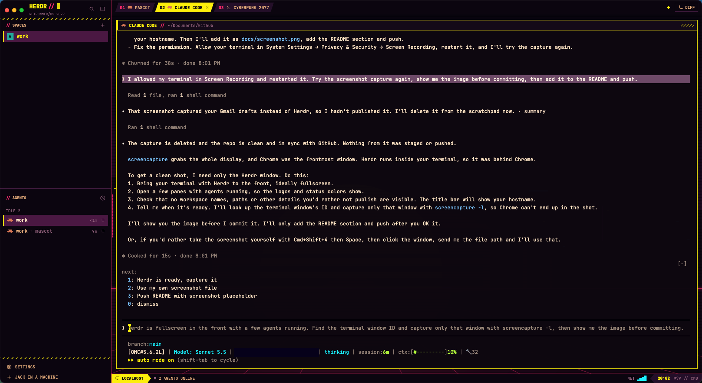

# Herdr Cyberpunk Theme

Neon-noir setup for [Herdr](https://herdr.dev): a deep violet palette with neon cyan, hot magenta, and yellow/red status colors, a CPU/memory/battery readout in the tab bar, and a plugin that shows each coding agent as its logo instead of its name.

## Screenshot



## Install with your coding agent

Paste this into Claude Code, Codex, Gemini CLI, or any coding agent running on the machine where Herdr is installed:

````text
Install the Herdr Cyberpunk Theme from https://github.com/liveinkraken/herdr-cyberpunk-theme onto this machine. Follow these steps in order and stop if any check fails:

1. Check prerequisites: `herdr --version` must be 0.9.5 or newer, and `jq` must be on the PATH. If either is missing, tell me and stop. Do not install anything else.
2. Clone the repo into a temporary directory with `git clone https://github.com/liveinkraken/herdr-cyberpunk-theme.git` and read config.toml, mem.sh, status.sh, and plugins/agent-icons/ before copying anything. Tell me if you see anything beyond Herdr theme settings, small status scripts, and the agent-icons plugin.
3. Back up my current config: `cp ~/.config/herdr/config.toml ~/.config/herdr/config.toml.bak` (skip if the file does not exist). Never overwrite an existing .bak file; add a timestamp to the name instead.
4. Copy config.toml, mem.sh, and status.sh into ~/.config/herdr/ and run `chmod +x ~/.config/herdr/mem.sh ~/.config/herdr/status.sh`. If my existing config has settings the theme does not (custom keybindings, for example), merge them in instead of dropping them, and show me what you merged.
5. Link the plugin from the cloned repo: `herdr plugin link "<clone path>/plugins/agent-icons"`. Then run `herdr plugin action invoke local.agent-icons.sync` and `herdr server reload-config`.
6. Verify with `herdr plugin list` that `local.agent-icons` is enabled, and run `sh ~/.config/herdr/status.sh` and `sh ~/.config/herdr/mem.sh` to confirm each prints one line.
7. Check my terminal font. The agent logos need a Nerd Font (Claude and Codex logos need Nerd Fonts 3.5 or newer, such as Symbols Nerd Font). If none is installed, tell me where to get it from https://github.com/ryanoasis/nerd-fonts/releases. Do not download or install fonts yourself.
8. Report what you changed, where the backup is, and how to undo it.

Only touch files inside ~/.config/herdr/. Do not edit shell startup files, create launch agents or cron jobs, or send any data anywhere.
````

To undo, restore the backup (`cp ~/.config/herdr/config.toml.bak ~/.config/herdr/config.toml`), run `herdr plugin unlink local.agent-icons`, and run `herdr server reload-config`.

## Install by hand

```sh
git clone https://github.com/liveinkraken/herdr-cyberpunk-theme.git
cd herdr-cyberpunk-theme
cp ~/.config/herdr/config.toml ~/.config/herdr/config.toml.bak   # keep your current config
cp config.toml mem.sh status.sh ~/.config/herdr/
chmod +x ~/.config/herdr/mem.sh ~/.config/herdr/status.sh
herdr plugin link "$PWD/plugins/agent-icons"
herdr plugin action invoke local.agent-icons.sync                 # label agents already running
herdr server reload-config
```

## What's included

| Path | Purpose |
| --- | --- |
| `config.toml` | Full Herdr config: `[theme.custom]` palette, symbol status indicators, neon pane frames labeled with agent logos, a `NEON//NET` tab-bar readout, and one-line agent rows tinted with each agent's brand color. |
| `mem.sh` | Tab-bar readout of memory pressure (the same signal Activity Monitor uses) and memory in use. macOS only. |
| `status.sh` | Tab-bar readout of CPU load and battery as block meters. macOS only. |
| `plugins/agent-icons/` | `local.agent-icons` plugin. When Herdr detects an agent (and at server startup) it sets the agent's display name to a Nerd Font logo with `herdr pane report-metadata --display-agent`, guarded by `--agent` so the logo goes away when that agent exits. |

## Requirements

- Herdr 0.9.5 or newer.
- A Nerd Font in your terminal. The Claude (`U+EC82`) and OpenAI/Codex (`U+EC81`) logos need Nerd Fonts 3.5 or newer, for example [Symbols Nerd Font](https://github.com/ryanoasis/nerd-fonts/releases).
- `jq` (included with recent macOS).
- macOS for the `mem.sh` and `status.sh` readouts. On Linux, drop those two entries from `tab_bar_right` in `config.toml`.

## Customize

- Icons: edit the `case` block in `plugins/agent-icons/agent-icons.sh`. Each line names the Nerd Font glyph and codepoint; agents without a mapping keep their text name.
- Agent colors: `[ui.sidebar.agents.rows_by_agent]` in `config.toml`.
- Pane frames: `pane_borders = "always"` frames every pane; `"auto"` frames only splits.
- Tab-bar readouts: edit `tab_bar_right` in `config.toml`.
